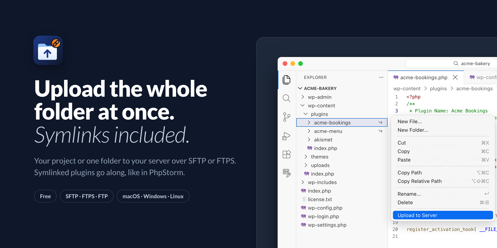
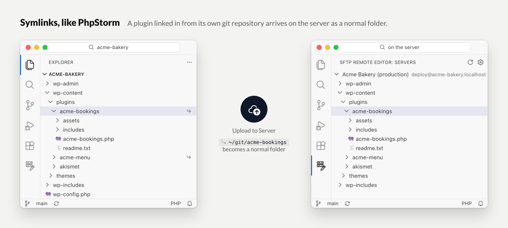
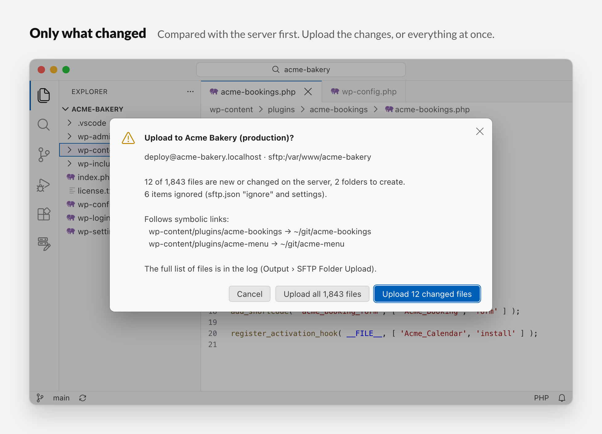
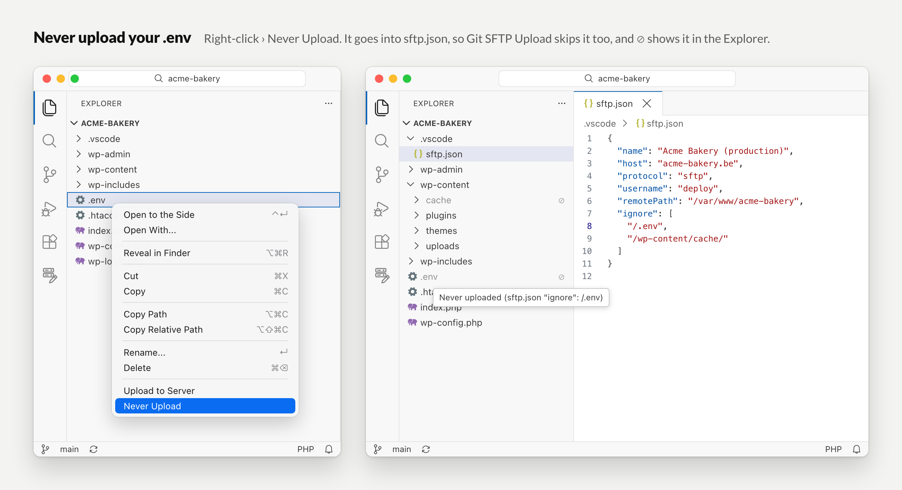
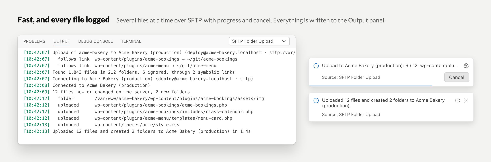

# SFTP Folder Upload



**Upload a folder, or your whole project, to your server in one go.** Right-click it in the Explorer, choose **Upload to Server**, and everything goes up over SFTP or FTPS. Symbolic links are followed, the way PhpStorm does it.

It reads the `.vscode/sftp.json` you already have, so there is nothing to set up.

[](https://marketplace.visualstudio.com/items?itemName=delta-solutions.sftp-folder-upload)
[](https://marketplace.visualstudio.com/items?itemName=delta-solutions.sftp-folder-upload)
[](LICENSE)

**Install:** search for *SFTP Folder Upload* in the Extensions view, or open `vscode:extension/delta-solutions.sftp-folder-upload`. Free, MIT licensed, macOS, Windows and Linux.

## Why

A WordPress site in one folder, and every plugin in its own git repository, symlinked into `wp-content/plugins`. PhpStorm uploads that site in one go and takes the plugins along. In VS Code the plugins were left out: upload tools skip symbolic links, or only upload files one at a time.

SFTP Folder Upload closes that gap:

- **Whole folders at once.** Right-click one or more files and folders, or upload the whole project from the Command Palette.
- **Symlinks included.** Linked folders and files are uploaded with their contents, at the place of the link in your project. On the server they are normal folders.
- **Only what changed.** The server is checked first. You see how many files are new or changed, and upload those, or everything.
- **Never upload your .env.** Right-click a file or folder › **Never Upload**, like *Exclude path* in PhpStorm. It is added to the `ignore` list of your sftp.json and marked with ⊘ in the Explorer. Git SFTP Upload respects the same list.
- **Nothing you don't want.** `.git`, `.vscode` and `.idea` stay home too. Nothing is ever deleted on the server.
- **Permissions stay as they are.** Existing files keep their owner and mode. New files get the server's defaults.
- **Your existing config.** Same `.vscode/sftp.json` as Git SFTP Upload, SFTP Remote Editor and the SFTP extension by Natizyskunk, including profiles and multiple servers.

## A quick tour

### Symlinks, like PhpStorm

`wp-content/plugins/acme-bookings` is a link to `~/git/acme-bookings`. Upload the site, or just that plugin, and its files arrive in `wp-content/plugins/acme-bookings` on the server, as a normal folder. A link that points back into its own parent folder is skipped instead of looping, and a broken link is reported in the log.



### Only what changed

Before anything is sent, the server is compared with your files. A file is uploaded when it is missing on the server, has another size, or is newer locally. The confirmation shows the target, the number of changed files, what is ignored, and which symbolic links are followed. After an upload, each file on the server gets the same modification time as your local copy, so the next run sees exactly what changed since.



### Never upload your .env

Right-click `.env`, a cache folder or anything else that must stay on your machine, and choose **Never Upload**. The path is added to the `ignore` list in `.vscode/sftp.json` (as `/.env` or `/wp-content/cache/`), for every server whose `context` contains it. From then on it is marked with ⊘ in the Explorer and is never uploaded, also not when you select it on its own. **Allow Upload** on the same item removes it from the list again.

Because the list lives in sftp.json, it is shared with your team through the repository, and Git SFTP Upload skips the same files. The SFTP extension by Natizyskunk skips them on save and in folder uploads, but its **Upload File** and **Force Upload** commands send a file you select on its own anyway: they ignore the list by design.



### Fast, and every file logged

Over SFTP several files are uploaded at the same time on one connection. The progress shows in a notification that you can cancel. Every followed link, every new folder and every uploaded file is written to the Output panel under *SFTP Folder Upload*.



## How it works

1. Install the extension.
2. Make sure your project has a `.vscode/sftp.json` (see below). If you use Git SFTP Upload, SFTP Remote Editor or the SFTP extension by Natizyskunk, you already have one.
3. Right-click a folder or file in the Explorer › **Upload to Server**. Or run **SFTP Folder Upload: Upload Project to Server** from the Command Palette.
4. Confirm. Done.

When more than one server matches (profiles, or an array of configs), you choose where to upload. The entry's `defaultProfile` is listed first.

## Configuration

A `.vscode/sftp.json` for a WordPress site:

```jsonc
{
  "name": "Acme Bakery (production)",
  "host": "acme-bakery.be",
  "protocol": "sftp",
  "username": "deploy",
  "privateKeyPath": "~/.ssh/id_ed25519",
  "remotePath": "/var/www/acme-bakery",
  "ignore": ["wp-content/uploads", "wp-content/cache", "*.log", "node_modules"]
}
```

Supported: `name`, `host`, `port`, `username`, `password`, `privateKeyPath`, `passphrase`, `agent`, `remotePath`, `context`, `connectTimeout`, `ignore`, `profiles`, `defaultProfile`, and an array of configs. `context` is the local folder that corresponds to `remotePath`. `ignore` uses gitignore syntax, relative to the context.

Protocols:

- `"protocol": "sftp"` (default): SFTP over SSH, with password, private key or agent authentication.
- `"protocol": "ftp"`: FTPS with explicit TLS on port 21 by default. `"secure": "implicit"` uses implicit FTPS on port 990. Unencrypted FTP is only used with an explicit `"secure": false`.

Settings:

| Setting | Default | |
| --- | --- | --- |
| `sftpFolderUpload.configFile` | `.vscode/sftp.json` | Path to the config, inside the workspace folder. |
| `sftpFolderUpload.followSymlinks` | `true` | Upload the contents of symbolically linked files and folders. Off: links are skipped. |
| `sftpFolderUpload.showNeverUploadInExplorer` | `true` | Mark what is in the `ignore` list of sftp.json with ⊘ in the Explorer. |
| `sftpFolderUpload.alwaysIgnore` | `.git` `.svn` `.hg` `.vscode` `.idea` `.DS_Store` `Thumbs.db` | Never uploaded, on top of the `ignore` list in sftp.json. |
| `sftpFolderUpload.confirm` | `true` | Ask before uploading. Off: the changed files are uploaded right away. |
| `sftpFolderUpload.parallelUploads` | `4` | Files uploaded at the same time over SFTP. FTP uploads one at a time. |

## Security

- **Host key verification (SFTP).** The server's SSH host key is checked against `~/.ssh/known_hosts`. Unknown hosts are shown once with their fingerprint and must be confirmed before the password is sent. A key that no longer matches is refused. Use **SFTP Folder Upload: Forget Trusted Host Keys** if a server key was changed on purpose.
- **No passwords on disk.** With `"password": true` the password is asked when needed and kept in memory for the session only. A plaintext password in `sftp.json` is flagged in the Output panel.
- **Never Upload is final.** A file in the `ignore` list is skipped in every upload, also when it is selected on its own, and never deleted on the server by Git SFTP Upload.
- **Your config stays home.** `.vscode` is ignored by default, so `sftp.json` is never uploaded with the project.
- **You see what is followed.** Every symbolic link that is followed is listed in the confirmation and the log, with its target.
- **Permissions are kept.** Files are written without changing their mode, so nothing becomes world-writable by being uploaded.
- **Trusted workspaces only.** The extension stays disabled in Restricted Mode, because the workspace itself decides which servers it connects to.

## FAQ

**Where is the Never Upload list stored?**
In the `ignore` list of `.vscode/sftp.json`, the same list the SFTP extension by Natizyskunk uses. Commit sftp.json (without passwords) and your whole team skips the same files. Note that Natizyskunk's **Upload File** and **Force Upload** on a single file do not check the list. Wider patterns such as `*.log` can be added by hand; the Explorer marks those files too.

**Does it delete files on the server that I deleted locally?**
No. It only uploads. Nothing on the server is ever removed.

**How does it know what changed?**
It compares size and modification time with the server. After an upload the server copy gets your local modification time, so an unchanged file compares equal next time. FTP servers without the `MFMT` command keep their own time; changed files are then found by size and by being newer locally. When in doubt, choose **Upload all**.

**Can I upload only the plugin I worked on?**
Yes. Right-click `wp-content/plugins/your-plugin` and choose **Upload to Server**. It is uploaded to the same place on the server, even though the folder is a symbolic link.

**How is this different from Git SFTP Upload?**
Git SFTP Upload uploads the files you changed in git, from the Source Control view. SFTP Folder Upload uploads whole folders, including symlinked ones, and compares with the server instead of with git. Both read the same `sftp.json`.

## Publisher

[Delta Solutions](https://www.deltasolutions.be/). Source on [GitHub](https://github.com/dietercoopman/sftp-folder-upload); issues and ideas are welcome there.
